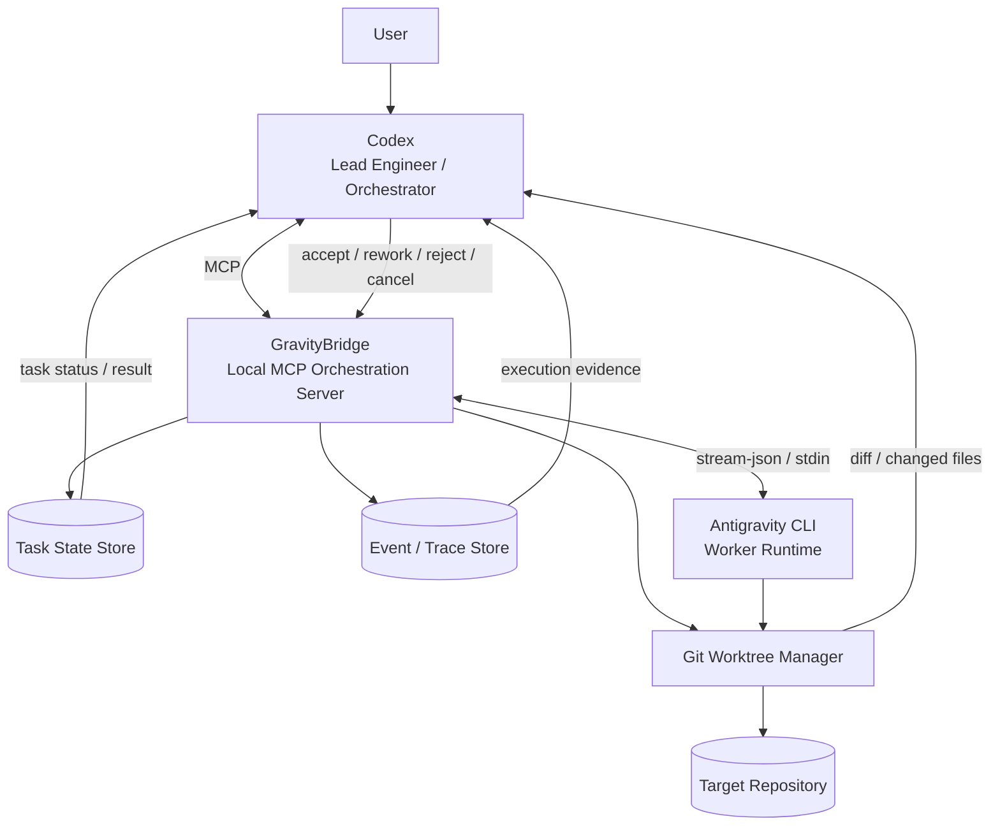
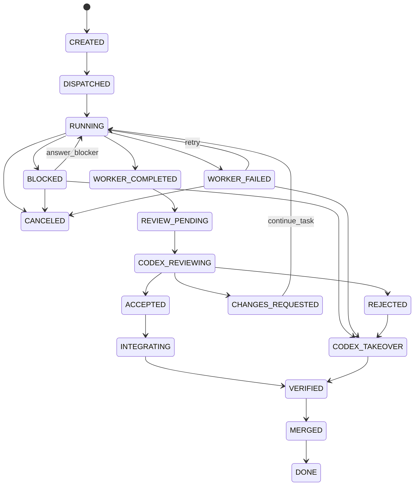
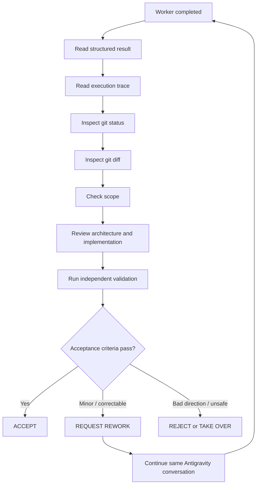
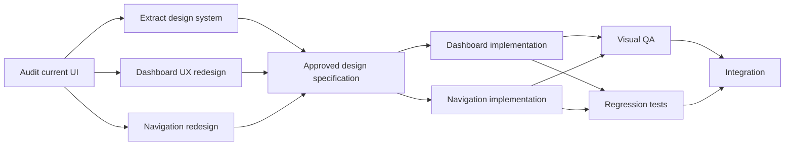

# Codex × Antigravity Orchestration Framework

**Status:** Architecture baseline  
**Version:** 1.0.0-draft  
**Primary role model:** Codex = Lead Engineer / Orchestrator; Antigravity CLI = Specialist Worker; GravityBridge = deterministic coordination layer.

---

## 1. Purpose

This framework defines a reproducible way for Codex and Antigravity CLI to collaborate on software-engineering projects without relying on GUI automation or informal prompt handoffs.

The framework is designed around three authorities:

1. **Codex owns orchestration and engineering judgment.**
   - Understands the target repository and architecture.
   - Decomposes objectives into bounded tasks.
   - Decides whether a task should be executed by Codex or delegated.
   - Reviews the actual codebase, Git diff, tests, build output, and acceptance criteria.
   - Decides whether work is accepted, reworked, rejected, or taken over.
   - Owns final integration.

2. **Antigravity CLI owns specialist execution.**
   - Runs bounded specialist tasks.
   - May inspect and modify files only inside the delegated workspace/scope.
   - Uses custom agents, skills, tools, subagents, and MCP where useful.
   - Produces a machine-readable result contract.
   - Never decides that its own work is accepted.

3. **GravityBridge owns coordination mechanics.**
   - Translates Codex task contracts into Antigravity executions.
   - Manages process lifecycle, state, conversations, worktrees, events, logs, and artifacts.
   - Detects Antigravity terminal completion from protocol-level events.
   - Returns structured evidence to Codex.
   - Does not make product or architecture decisions.

---

## 2. Non-negotiable principles

### 2.1 Worker success is not task acceptance

An Antigravity terminal result such as `SUCCESS` means that the worker process completed successfully. It does **not** prove that the implementation is correct.

The authoritative lifecycle is:

```text
ANTIGRAVITY TERMINAL SUCCESS
          |
          v
WORKER_COMPLETED
          |
          v
CODEX REVIEW
     /      |       \
 ACCEPT   REWORK   REJECT
```

### 2.2 Codex independently verifies claims

After every mutating Antigravity task, Codex must inspect evidence rather than trusting prose:

- Git status
- Git diff
- changed-file list
- task event trace
- worker structured result
- tests
- lint
- build/typecheck
- architecture impact
- scope violations
- security implications
- UX or visual acceptance criteria when applicable

### 2.3 Single-writer isolation

Codex and Antigravity must not concurrently edit the same working tree.

Every mutating delegated task should receive an isolated Git worktree and branch:

```text
target-repo/
├── main workspace        <- Codex
└── .worktrees/
    └── GB-<task-id>/     <- Antigravity
```

### 2.4 Structured contracts over free-form coordination

Codex delegates a **Task Contract**. Antigravity returns a **Result Contract**. GravityBridge stores an **Event Trace** and task state.

Free-form prose can supplement these contracts, but it must not replace them.

### 2.5 Explicit lifecycle

Task status is controlled by a state machine. Model prose must never mutate lifecycle state directly.

---

## 3. System architecture



---

## 4. Responsibility model

| Capability | Codex | GravityBridge | Antigravity |
|---|---:|---:|---:|
| Understand product objective | Owner | No | Context only |
| Understand target repo architecture | Owner | Metadata only | Task-scoped |
| Decompose work | Owner | No | Optional subtasking inside task |
| Select specialist worker | Owner | Enforce request | Execute |
| Create isolated worktree | Request | Owner | Consume |
| Execute specialist task | Optional | Launch/monitor | Owner |
| Track process completion | Observe | Owner | Emit protocol result |
| Persist event trace | Read | Owner | Emit |
| Review implementation | Owner | Provide evidence | No |
| Run independent validation | Owner | Optional helper | May self-check |
| Decide accept/rework/reject | Owner | Persist | No |
| Merge/integrate | Owner | Optional helper | Never |

---

## 5. Task lifecycle



### Terminal worker states

GravityBridge treats the Antigravity CLI terminal `result` event as the process-level completion signal.

The bridge maps worker outcomes to orchestration state. A successful worker execution moves to `WORKER_COMPLETED`, not directly to `ACCEPTED`.

---

## 6. Task Contract

Every delegated task must define:

- stable `task_id`
- task type
- goal
- base commit SHA
- allowed and forbidden paths
- acceptance criteria
- context files
- desired Antigravity agent
- reasoning effort
- validation commands
- retry/rework limits
- mutation policy
- optional dependencies on other tasks

Example:

```json
{
  "task_id": "GB-UX-042",
  "type": "frontend_ui",
  "goal": "Redesign the ERP dashboard information hierarchy.",
  "base_sha": "91ab3f...",
  "scope": {
    "allowed_paths": [
      "src/app/dashboard/**",
      "src/components/dashboard/**"
    ],
    "forbidden_paths": [
      "src/server/**",
      "src/db/**"
    ]
  },
  "acceptance_criteria": [
    "Do not alter backend API contracts.",
    "Existing dashboard routes must remain functional.",
    "npm run build must pass.",
    "npm run lint must pass."
  ],
  "context": [
    "docs/design-system.md",
    "docs/erp-domain.md"
  ],
  "worker": {
    "agent": "frontend-specialist",
    "effort": "high"
  },
  "limits": {
    "max_retries": 2,
    "max_rework_cycles": 3
  }
}
```

The canonical schema lives in `schemas/task.schema.json`.

---

## 7. Result Contract

Antigravity must produce a schema-constrained result when possible.

Example:

```json
{
  "schema_version": "1.0",
  "task_id": "GB-UX-042",
  "worker_status": "completed",
  "summary": "Refactored dashboard layout and KPI hierarchy.",
  "files_changed": [
    "src/app/dashboard/page.tsx",
    "src/components/dashboard/KpiCard.tsx"
  ],
  "commands_run": [
    "npm run lint",
    "npm run build"
  ],
  "validation": {
    "lint": "passed",
    "build": "passed"
  },
  "assumptions": [],
  "known_issues": [],
  "blockers": [],
  "recommendations": [
    "Perform independent visual QA at 1366x768."
  ]
}
```

The bridge records the actual Antigravity `conversation_id` separately from worker-authored fields and persists it with task metadata.

---

## 8. Completion signaling

GravityBridge must never infer completion from phrases such as “done”, “finished”, or “implemented”.

For Antigravity headless execution, the preferred transport is:

```text
agy ... --output-format stream-json
```

The expected stream is:

```text
init
step_update*
result
```

A terminal `result` event closes one worker turn. The bridge records:

- conversation ID
- terminal worker status
- response
- structured output
- duration
- usage
- observed tool steps
- process exit code
- stderr diagnostics

For multi-turn persistent execution, the bridge may use:

```text
--input-format stream-json --output-format stream-json
```

V1 may use one process per turn and resume with `--conversation <id>` for simpler process isolation.

---

## 9. Codex review protocol

After `WORKER_COMPLETED`, Codex should perform the following review sequence:



The worker's own build/test claims are evidence, not authority. Codex may rerun them.

---

## 10. Rework protocol

When review finds correctable issues, Codex sends a narrow rework request through GravityBridge.

Rework should:

- preserve accepted work
- name blocking findings
- identify allowed files
- prohibit redesign unless necessary
- specify validation commands
- reuse the previous `conversation_id`
- increment the rework cycle counter

Example:

```text
Your previous implementation is mostly accepted.

Codex review found two blocking issues:
1. The dashboard overflows horizontally at 1366x768.
2. KPI typography bypasses the existing design token.

Do not redesign the screen.
Modify only DashboardGrid.tsx and KpiCard.tsx.
Preserve all accepted behavior.
Run lint and build before returning the result contract.
```

---

## 11. Retry and failure policy

Recommended defaults:

```text
max_worker_retries = 2
max_rework_cycles = 3
max_same_failure = 2
```

A retry is for execution failure or transient failure.

A rework cycle is for a completed worker result that Codex reviewed and found correctable.

Repeated identical failures should trigger Codex takeover rather than an infinite agent loop.

---

## 12. Blocker handling

A task can enter `BLOCKED` when Antigravity cannot proceed safely without a decision.

A blocker must be structured:

```json
{
  "type": "architectural_decision",
  "question": "Should KPI cards reuse LegacyMetric or migrate to MetricCardV2?",
  "options": ["LegacyMetric", "MetricCardV2"],
  "evidence": [
    "LegacyMetric is used by four existing pages.",
    "MetricCardV2 matches current design tokens."
  ]
}
```

Codex should answer the blocker itself when the repository and objective provide enough evidence. User escalation is reserved for genuinely product-level ambiguity.

---

## 13. Git isolation model

For mutating work, GravityBridge should create:

```text
branch: gb/<task-id>
worktree: <target-repo>/.worktrees/gb-<task-id>
```

Rules:

1. Antigravity may write only inside its assigned worktree.
2. Antigravity must not merge to the target branch.
3. Antigravity must not push unless explicitly enabled by policy.
4. Codex reviews the worktree diff against the recorded base SHA.
5. Integration occurs only after Codex acceptance.
6. Dirty target repositories require an explicit policy decision before delegation.

---

## 14. MCP surface

V1 should expose a small bounded toolset:

### Execution

- `delegate_and_wait`
- `retry_task`
- `continue_task`
- `cancel_task`

### Inspection

- `get_task`
- `get_task_events`
- `get_task_diff`
- `get_worker_result`

### Optional V1.1

- `list_tasks`
- `answer_blocker`
- `worker_health`
- `cleanup_task`

Avoid a generic `antigravity_do_everything` tool. Each tool should have explicit semantics and bounded side effects.

---

## 15. Synchronous V1

The first implementation intentionally favors synchronous delegation:

```text
Codex
  |
  | delegate_and_wait(task)
  v
GravityBridge
  |
  | spawn Antigravity
  v
Antigravity working
  |
  | terminal result
  v
GravityBridge captures evidence
  |
  | MCP tool returns
  v
Codex immediately resumes review
```

This solves the core requirement—“when Antigravity finishes, Codex knows and continues”—without requiring a background wake-up service.

---

## 16. Asynchronous V2

A future supervisor can use Codex app-server to wake and resume a Codex thread after an asynchronous worker completion event.

Conceptual flow:

```text
GravityBridge task.completed
        |
        v
Supervisor
        |
        | thread/resume + turn/start
        v
Codex review turn
```

V2 is deliberately outside the V1 critical path.

---

## 17. Specialist worker model

Recommended Antigravity agents:

- `erp-ux-researcher`
- `ui-designer`
- `frontend-specialist`
- `design-system-specialist`
- `visual-qa`

The specialist set is extensible. Agent selection belongs to Codex.

---

## 18. Project bootstrap model

The orchestration repository is a reusable control plane. It is not copied wholesale into every product repository.

For each target project, Codex should:

1. Locate the GravityBridge repository.
2. Read the Codex orchestration skill and protocol references, including `protocol/PROJECT_BOOTSTRAP.md`.
3. Run the project bootstrap/doctor command.
4. Ensure Antigravity CLI is installed and authenticated.
5. Ensure the Antigravity worker plugin is installed or synchronized.
6. Create or update target-project coordination config.
7. Start GravityBridge MCP.
8. Verify worker health.
9. Begin delegation.

The bootstrap flow should be idempotent.

---

## 19. Security model

Default posture is least privilege.

### Codex

- Full repository review authority.
- Integration authority.
- May delegate only within user/project permissions.

### GravityBridge

- May create task state and worktrees.
- May spawn Antigravity.
- Must validate paths against the target repository.
- Must not execute arbitrary user-supplied shell strings as orchestration commands.

### Antigravity

- Worktree-scoped write authority.
- No main-branch merge authority.
- No push by default.
- No unrestricted filesystem access by default.
- Shell permissions must follow Antigravity's platform-specific permission model.
- Do not use `--dangerously-skip-permissions` as the default.

---

## 20. Observability

Each task should produce a durable local bundle:

```text
.gravitybridge/
└── tasks/
    └── <task-id>/
        ├── task.json
        ├── prompt.md
        ├── events.ndjson
        ├── stdout.log
        ├── stderr.log
        ├── result.json
        ├── metadata.json
        ├── diff.patch
        └── review.json
```

This provides a useful audit trail for Codex and humans.

---

## 21. Framework layers

| Layer | Responsibility |
|---|---|
| L1 Codex Intelligence | planning, architecture, delegation, review |
| L2 Orchestration Protocol | contracts, lifecycle, retry/rework policy |
| L3 GravityBridge MCP | deterministic coordination and tools |
| L4 Antigravity Runtime | specialist execution |
| L5 Git Isolation | worktrees, branches, diff boundaries |
| L6 Observability | state, events, logs, metrics, audit artifacts |

---

## 22. Recommended implementation phases

### Phase 1 — GravityBridge V1

- Codex plugin/skills
- local MCP bridge
- synchronous `delegate_and_wait`
- Antigravity headless execution
- schema-constrained worker output
- Git worktree isolation
- event/result persistence
- Codex review and rework workflow
- Windows-first bootstrap plus macOS/Linux scripts

### Phase 2 — Persistent Antigravity sessions

- streaming prompts over stdin
- persistent process/session manager
- live progress
- blocker callback support
- richer worker health

### Phase 3 — Autonomous supervisor

- Codex app-server
- asynchronous task queue
- automatic thread resume
- DAG scheduler
- parallel independent workers
- dependency-aware integration

---

## 23. Task DAG model

Larger objectives should be decomposed into dependency-aware tasks.



V1 stores optional dependencies in the task contract but does not need a full autonomous scheduler.

---

## 24. Definition of done for the framework

The framework is functioning correctly when the following closed loop works without manual GUI control:

```text
User objective
  -> Codex inspects project
  -> Codex creates bounded task
  -> Codex calls GravityBridge
  -> GravityBridge creates worktree
  -> GravityBridge runs Antigravity
  -> Antigravity emits terminal result
  -> GravityBridge captures evidence
  -> MCP call returns to Codex
  -> Codex independently reviews
  -> Codex accepts or sends targeted rework
  -> same conversation is resumed when appropriate
  -> Codex verifies and integrates accepted work
```

That loop is the core product.

---

## 25. Official capability references

The design intentionally builds on documented capabilities rather than GUI automation:

- OpenAI plugin architecture: https://developers.openai.com/plugins/concepts/plugins
- OpenAI plugin packaging: https://developers.openai.com/plugins/build/plugins
- OpenAI Codex app-server: https://developers.openai.com/siwc/token-sharing-open-source/codex-app-server
- Antigravity CLI headless mode: https://antigravity.google/docs/cli/headless/
- Antigravity CLI features: https://antigravity.google/docs/cli/features/
- Antigravity plugins: https://antigravity.google/docs/plugins
- Antigravity custom agents: https://antigravity.google/docs/cli/commands/agents/
- Antigravity permissions: https://antigravity.google/docs/permissions

---

## 26. Repository contract

This repository is intended to be loaded by Codex as a reusable orchestration/control repository. The canonical V1 implementation details live in `protocol/SPECIFICATION_V1.md`.

The target product repository remains the source of truth for product code. GravityBridge is the source of truth for orchestration semantics.
