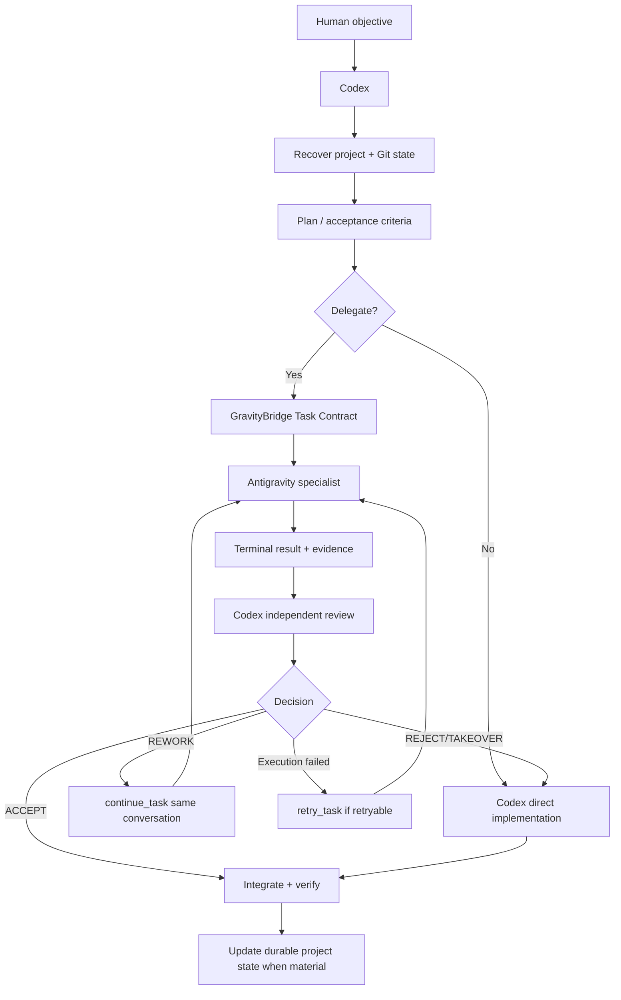

# GravityBridge Prompt System

**Version:** 1.0  
**Status:** Canonical lifecycle routing for Human → Codex and Codex → Antigravity

## 1. Purpose

The prompt system gives a predictable operating sequence for:

- machine bootstrap;
- first-time target-project bootstrap;
- fresh Codex session recovery;
- normal daily engineering;
- worker review/rework/retry;
- interruption recovery;
- state reconciliation;
- session close/handoff;
- requirement changes;
- debugging;
- release gates.

The system is inspired by durable prompt/lifecycle workflows, but adapted to GravityBridge's core architectural difference:

> Human does not normally relay prompts between Codex and Antigravity.

Codex owns the orchestration loop and communicates with Antigravity through GravityBridge.

## 2. Two prompt layers

### Layer A — Human → Codex lifecycle prompts

Canonical directory:

`prompts/`

IDs:

`GB-H01` through `GB-H11`.

These prompts establish operating mode and user intent.

### Layer B — Codex → Antigravity execution templates

Canonical directory:

`prompts/templates/`

Key templates:

- `GB-A-TASK`
- `GB-A-REWORK`
- `GB-A-RETRY`
- `GB-C-REVIEW`

GravityBridge currently renders equivalent execution prompts programmatically from the Task Contract.

The Markdown templates are the semantic reference and review surface. Runtime code and templates SHOULD remain aligned.

## 3. Human lifecycle routing

```text
Machine not ready
  -> GB-H01

Target project not bootstrapped
  -> GB-H02

Fresh Codex session
  -> GB-H03

Normal objective
  -> GB-H04

Outstanding worker result after interruption
  -> GB-H05

Long interruption / lost context
  -> GB-H06

Repository/bridge/memory drift
  -> GB-H07

End of working session
  -> GB-H08

Requirement changed
  -> GB-H09

Bug/regression
  -> GB-H10

Merge/release/deploy readiness
  -> GB-H11
```

## 4. Daily closed loop



## 5. Project Coordination Memory

Target projects SHOULD use:

```text
docs/GRAVITYBRIDGE/
├── PROJECT_PROFILE.md
├── CURRENT_STATE.md
├── SESSION_HANDOFF.md
├── DECISION_LOG.md
└── TASK_LEDGER.md
```

Why both project memory and bridge runtime state exist:

- `~/.gravitybridge/` stores detailed local task execution evidence.
- `docs/GRAVITYBRIDGE/` stores small durable cross-session coordination facts in the target project.

Project memory does not duplicate event logs or hidden reasoning.

## 6. Prompt trace keys

Human lifecycle prompt IDs identify **operating mode**, not one implementation instance.

Each actual delegated task still receives a unique `task_id`.

Recommended task IDs:

```text
GB-<AREA>-<NNN>
GB-UI-001
GB-AUTH-004
GB-BUG-017
```

A task may have:

- one initial Antigravity execution;
- zero or more execution retries;
- zero or more rework cycles;
- exactly one final Codex acceptance/rejection path.

## 7. Resume philosophy

Fresh sessions MUST recover from durable evidence:

1. target AGENTS;
2. Project Coordination Memory;
3. Git state;
4. GravityBridge task metadata/evidence;
5. product/project contracts.

Chat history is not authoritative.

## 8. Sync philosophy

A sync/reconcile operation compares:

- local HEAD;
- upstream/default HEAD;
- dirty state;
- project memory claims;
- task ledger;
- GravityBridge task/worktree state;
- exact accepted/reviewed SHAs.

Do not use the word "latest" as a substitute for an exact review target when correctness depends on SHA identity.

## 9. Session close philosophy

A clean session handoff should let a new Codex session answer:

- Where are we?
- What was accepted?
- What remains?
- What is blocked?
- What exact branch/SHA are we on?
- What is the next safe action?

without reading the previous chat.

## 10. Relation to GravityBridge code

Current runtime prompt generation lives in:

`packages/gravitybridge/src/prompt.ts`.

Any future changes to worker authority, result requirements, rework semantics or retry semantics SHOULD update both:

- runtime prompt generation;
- `prompts/templates/`.

## 11. Human interaction principle

Normal interaction is:

```text
Human -> Codex -> GravityBridge -> Antigravity
                    ^              |
                    |---- evidence-|
```

Not:

```text
Human -> Codex -> copy/paste -> Antigravity -> copy/paste -> Codex
```

Manual relay remains only a fallback when the bridge is unavailable.
