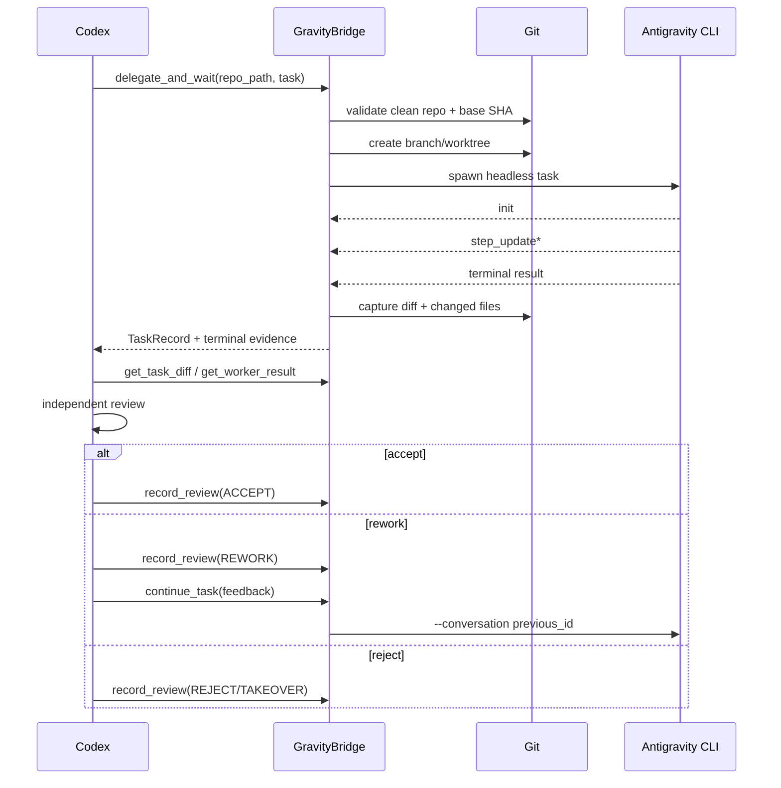

# GravityBridge Technical Specification V1

**Version:** 1.0.0  
**Status:** Implemented baseline  
**Normative language:** The key words MUST, MUST NOT, SHOULD, SHOULD NOT, and MAY are to be interpreted as requirement levels.

## 1. Objective

GravityBridge V1 provides deterministic synchronous orchestration between Codex and Antigravity CLI.

The primary requirement is:

> When Antigravity finishes a delegated task, Codex must receive a machine-detectable completion result and immediately regain control with sufficient evidence to independently review the work.

V1 deliberately avoids GUI automation and does not require a background Codex wake-up service.

## 2. Actors

### 2.1 Codex

Codex MUST be treated as the Lead Engineer / Orchestrator.

Codex owns:

- repository-level understanding;
- architecture decisions;
- task decomposition;
- worker selection;
- acceptance criteria;
- post-worker review;
- retry/rework decisions;
- final integration.

### 2.2 Antigravity CLI

Antigravity is a specialist execution runtime.

Antigravity MAY:

- inspect the assigned worktree;
- modify files inside delegated scope;
- run allowed commands;
- use its tools, skills, agents, subagents, and MCP servers;
- report blockers;
- self-validate.

Antigravity MUST NOT be treated as final acceptance authority.

### 2.3 GravityBridge

GravityBridge is a local MCP server.

It owns:

- task persistence;
- worktree creation;
- Antigravity process launch;
- stream event capture;
- terminal result detection;
- conversation ID persistence;
- evidence capture;
- task state persistence.

It MUST NOT make product or architecture judgments.

## 3. Transport

V1 uses MCP stdio between Codex and GravityBridge.

GravityBridge launches Antigravity CLI with:

```text
agy -p <prompt>
    --output-format stream-json
    --json-schema <result.schema.json>
    --effort <low|medium|high>
    --agent <agent>
    --print-timeout <duration>
```

Optional:

```text
--model <model>
--conversation <conversation_id>
```

GravityBridge MUST NOT add `--dangerously-skip-permissions` by default.

## 4. Antigravity completion protocol

Antigravity headless streaming output is treated as NDJSON.

The expected high-level sequence is:

```text
init
step_update*
result
```

GravityBridge MUST identify completion from the terminal `result` event, not from natural-language output.

A worker turn is successful at the process layer only when:

1. a terminal result event is observed;
2. process exit code is 0;
3. terminal envelope status is `SUCCESS`;
4. schema-constrained `structured_output` exists;
5. structured output declares `worker_status` as `completed` or `blocked`.

Mapping:

| Antigravity/process outcome | GravityBridge state |
|---|---|
| SUCCESS + worker_status=completed | WORKER_COMPLETED |
| SUCCESS + worker_status=blocked | BLOCKED |
| Missing terminal result | WORKER_FAILED |
| Non-zero exit | WORKER_FAILED |
| ERROR / INVALID / INTERRUPTED | WORKER_FAILED |
| cancellation request terminates child | CANCELED or WORKER_FAILED depending observed terminal evidence |

V1 currently records best-effort cancellation and does not guarantee a process-tree kill on every operating system.

## 5. Synchronous control loop



## 6. Git model

V1 requires a clean target working tree before initial delegation.

Reason: a new worktree is created from a commit SHA and cannot automatically include uncommitted Codex changes. Requiring cleanliness prevents hidden divergence between Codex context and worker context.

Initial delegation MUST verify that `task.base_sha` matches repository HEAD.

Worktrees are stored outside the target repository:

```text
~/.gravitybridge/
├── tasks/<repo-key>/<task-id>/
└── worktrees/<repo-key>/<task-id>/
```

Branch naming:

```text
gb/<task-id>
```

Antigravity MUST NOT merge or push by default.

## 7. Persistence

Per-task files:

```text
~/.gravitybridge/tasks/<repo-key>/<task-id>/
├── task.json
├── metadata.json
├── prompt.md
├── events.ndjson
├── stderr.log
├── result.json
├── diff.patch
└── review.json
```

The event trace SHOULD preserve raw Antigravity stream-json lines.

## 8. Task states

Implemented V1 states:

- CREATED
- DISPATCHED
- RUNNING
- BLOCKED
- WORKER_COMPLETED
- WORKER_FAILED
- CANCELED
- REVIEW_PENDING
- CODEX_REVIEWING
- ACCEPTED
- CHANGES_REQUESTED
- REJECTED
- CODEX_TAKEOVER
- INTEGRATING
- VERIFIED
- MERGED
- DONE

Not every integration state is automatically transitioned in V1. Integration remains Codex-owned.

## 9. MCP tool contract

### 9.1 delegate_and_wait

Side effects:

- validates target Git repository;
- requires clean working tree;
- validates base SHA;
- creates branch and worktree;
- writes task metadata;
- launches Antigravity;
- waits for terminal result;
- stores events/result/diff;
- returns TaskRecord.

This tool is intentionally synchronous.

### 9.2 continue_task

Requirements:

- task exists;
- prior conversation ID exists;
- current state permits rework/blocker continuation;
- rework budget is not exhausted.

Behavior:

- resumes same Antigravity conversation with `--conversation`;
- reuses same worktree;
- sends targeted Codex feedback;
- captures a new terminal result;
- updates the same task record.

### 9.3 get_task

Read-only task metadata lookup.

### 9.4 get_task_events

Read-only tail of raw NDJSON worker events.

### 9.5 get_worker_result

Read-only persisted result bundle.

### 9.6 get_task_diff

Read-only current task diff against recorded base SHA.

### 9.7 record_review

Persists Codex's independent decision.

Mapping:

| Decision | State |
|---|---|
| ACCEPT | ACCEPTED |
| REWORK | CHANGES_REQUESTED |
| REJECT | REJECTED |
| TAKEOVER | CODEX_TAKEOVER |

ACCEPT does not merge.

### 9.8 cancel_task

Best-effort cancellation of an active child process.

### 9.9 worker_health

Checks prerequisites without consuming an Antigravity model turn.

## 10. Review protocol

Codex SHOULD perform:

1. worker result inspection;
2. event inspection when useful;
3. actual diff inspection;
4. changed-file scope check;
5. code correctness review;
6. architecture review;
7. dependency/security review;
8. independent build/lint/test/typecheck when appropriate;
9. acceptance-criteria-by-criteria verification.

Codex MUST NOT accept work solely because the worker reports tests as passed.

## 11. Rework protocol

Rework MUST be targeted.

Codex SHOULD:

- enumerate blocking findings;
- preserve accepted work;
- restrict files when possible;
- avoid full redesign unless required;
- reuse the existing conversation;
- stop after the configured rework budget.

## 12. Task contract

Canonical machine schema: `schemas/task.schema.json`.

V1 requires:

- schema_version;
- task_id;
- type;
- goal;
- base_sha;
- path scope;
- acceptance criteria;
- worker agent and effort.

## 13. Result contract

Canonical machine schema: `schemas/result.schema.json`.

The Antigravity result MUST include:

- exact task ID;
- worker status;
- summary;
- changed-file claims;
- commands run;
- validation claims;
- assumptions;
- known issues;
- blockers;
- recommendations.

GravityBridge separately captures actual Git changed files so Codex can compare claims with repository evidence.

## 14. Security

V1 security posture:

- no automatic permission bypass;
- no automatic push;
- no automatic merge;
- isolated worktree;
- clean-base requirement;
- explicit task scope;
- bounded MCP tools;
- no generic arbitrary-shell MCP tool;
- Codex remains integration authority.

## 15. Failure semantics

Execution failure and review failure are different.

### Execution failure

Examples:

- `agy` missing;
- authentication failure;
- invalid model/agent;
- non-zero exit;
- no terminal result;
- schema output missing.

Result: `WORKER_FAILED`.

### Review failure

Worker completed but Codex finds defects.

Result: `REWORK`, `REJECT`, or `TAKEOVER`.

## 16. Known V1 limitations

- No asynchronous Codex wake/resume supervisor.
- No automatic dependency DAG scheduler.
- No automatic merge/integration tool.
- Cancellation is best-effort.
- Worktree/branch cleanup is manual.
- Path scope is communicated and reviewed but V1 does not yet hard-block filesystem writes by glob at OS level.
- Antigravity permission behavior remains governed by its own permission system.
- V1 requires a clean committed base and does not mirror uncommitted Codex changes.

These limitations are intentional and should not be hidden.

## 17. V1 definition of done

V1 is successful when:

1. Codex can call `worker_health`;
2. Codex can delegate a valid task;
3. a separate Git worktree is created;
4. Antigravity runs headlessly with structured output;
5. terminal result is detected deterministically;
6. task evidence is persisted;
7. the MCP call returns to Codex;
8. Codex can inspect result/events/diff;
9. Codex can persist ACCEPT/REWORK/REJECT/TAKEOVER;
10. REWORK can resume the same Antigravity conversation.

## 18. V2 direction

V2 may add:

- persistent Antigravity stdin streaming sessions;
- asynchronous queue;
- Codex app-server supervisor;
- task-completed event -> Codex thread resume;
- dependency DAG;
- parallel independent workers;
- automatic integration gates;
- richer visual QA artifacts.
